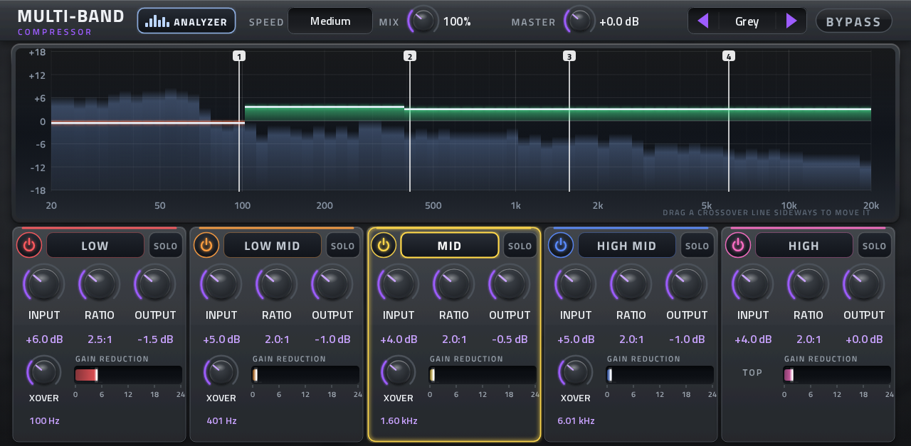

# Multi-Band Compressor

A 5-band compressor for Akai MPC standalone hardware, with the look and touch screen of
[Shapey 5-Band EQ](https://github.com/Cmackg/Shapey-MPC). Runs on the **MPC Live III** and every other MPC with
**MPC OS 3.10.1** or later (one folder for 64-bit and 32-bit MPCs).



## What it does
The sound is split into five bands (LOW, LOW MID, MID, HIGH MID, HIGH) and each band has its own compressor.

Each band has just four controls:
- **XOVER**: where the band ends and the next one starts (bands 1-4). Turn the knob, or **touch the graph and drag a
  crossover line sideways**: the nearest one follows your finger.
- **INPUT**: how hard the band is driven into its compressor. Turn it up to compress more (the threshold is fixed at
  -20 dBFS with a soft knee, so INPUT is the "amount").
- **RATIO**: how strongly it compresses, 1:1 (none) to 20:1.
- **OUTPUT**: the band's level after compression.

Plus a power switch (off = the band passes untouched), **SOLO**, and a **gain-reduction meter** per band.

On top: **SPEED** (Fast / Medium / Slow attack and release for every band; the low bands are automatically slower and
the high ones faster, so bass doesn't distort), **MIX** (parallel compression), **MASTER**, **ANALYZER**, four colour
**themes** and **BYPASS**.

The graph shows what each band is doing to the sound **right now**, the way Logic's Multipressor does: every band is a
flat bar across its own frequency range at its gain change (INPUT and OUTPUT minus the compression), stepping at the
crossover lines. The bar is filled from 0 dB: **red** when the band is being pulled down (compressed), **green** when
it is raised. Behind it, the analyzer shows the sound after the plugin.

9 built-in presets: Init, Gentle Glue, Mix Bus, Drum Punch, Tight Low End, Vocal Control, De-Harsh, Loud Master,
Parallel Squash. Q-Links: page 1 = bands 1-4 (XOVER, INPUT, RATIO, OUTPUT in a column each), page 2 = band 5, MIX,
MASTER, SPEED.

## Install
Download `Multi-Band-Compressor-<version>-mpc.zip` from [Releases](../../releases) (or build it, below) and follow its
[INSTALL.md](INSTALL.md):
1. MPC OS 3.10.1 or later, with **Preferences → Enhancements → Enable Enhancements** and **External Plugin Support** on.
2. Copy the folder `Cmackg - VST - Multi-Band Compressor` itself into a `VST2 Plugins` folder at the top of a drive, so
   that `plugin.json` is at `VST2 Plugins/Cmackg - VST - Multi-Band Compressor/plugin.json` (not one folder deeper).
3. Insert **Multi-Band Compressor** on a track (External VST Plugins).

## How it works
- **Crossovers**: 4th-order Linkwitz-Riley (24 dB/oct), split as a tree with matching allpasses on the lower bands, so
  the five bands add back to a flat response (measured: within 0.02 dB from 20 Hz to 20 kHz). Zero latency.
- **Compressors**: stereo-linked peak detection, soft-knee gain computer, and the "smooth decoupled" log-domain
  attack/release detector (Giannoulis, Massberg & Reiss, JAES 2012).
- **MIX** blends with the same bands unprocessed, so parallel compression doesn't comb.
- Every knob glides or fades (about 10-20 ms): no clicks from any control.
- Signal flow and details: the comment at the top of [src/engine.cpp](src/engine.cpp).

## Status
- Offline: every test passes (see Tests). CPU about 1% of one desktop core per instance with all five bands working.
- **Tested on an MPC Live III, MPC OS 3.10.1** (first quick test, 2026-11-14: loads and works as intended; see
  [tested.json](tested.json)). The 32-bit build comes from the same source and toolchain, not yet run on a 32-bit MPC.
- The live screen (curve, meters, analyzer) is reported to MPC from a background thread of the wrapper's (not the audio
  thread), the setting the toolchain recommends after measuring audio stalls with constantly moving meters on a Live III.

## Build
Needs [mpc-vst-plugins](https://github.com/3dthc/mpc-vst-plugins) (Shapey's toolchain) next to this repo at commit
`860807012d78a1b997863fae618f72d0da5945d1`, Python 3 with Pillow and Playwright (Chromium), and Zig (`pip install
ziglang`). No Docker.
```bash
git clone https://github.com/3dthc/mpc-vst-plugins ../mpc-vst-plugins
git -C ../mpc-vst-plugins checkout 860807012d78a1b997863fae618f72d0da5945d1
./build.sh 1.0.0                    # -> dist/Multi-Band-Compressor-1.0.0-mpc.zip
```
Optional: `SDK=<Akai mpc-plugin-builder-sdk checkout> ./build.sh` also runs Akai's validator on the folder.

The skin is pre-drawn and committed: `tools/make_params.py` writes the parameter list and presets,
`tools/make_skin_art.py` redraws the artwork and `mbc/layout.conf`, `tools/preview_demo.py` renders the screenshots.

## Tests
```bash
SDK=<Akai SDK checkout> ./test.sh
```
1. `tests/test_comp.py`: 57 checks of the DSP against textbook values: crossover flatness and LR4 band shapes,
   static compression and the knee, INPUT / OUTPUT / RATIO, stereo link, attack and release for each SPEED, slower bass,
   MIX without combing, SOLO, bit-exact BYPASS, the screen values (curve, crossover lines, meters, analyzer, graph
   drag), state save/load, no clicks from any control, silence, CPU.
2. The toolchain's host test under AddressSanitizer / UBSan: PASSED.
3. Akai's `host_sim`: everything passes except its state check, which also counts the display-only values (curve,
   analyzer, touch glow). The engine recomputes those instead of saving them, as Shapey does; every setting comes back.

## Licence and credits
MIT. See [LICENSE](LICENSE).
- The screen design, themes, curve display, analyzer, glides and RBJ filter maths come from **Shapey EQ** by 3DTHC
  (MIT, Copyright (c) 2026 3DTHC).
- Built with **mpc-vst-plugins** (MIT, Copyright (c) 2026 sd88me): the VST2 wrapper, skin builder and packaging; the
  fonts used to draw the skin (Titillium Web, SIL Open Font License) come from it.
- The plugin folder is checked with Akai's **MPC Plugin SDK** validator and host simulator.
